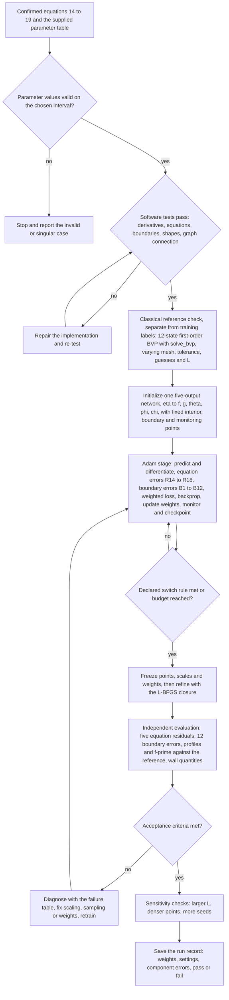

# Five-variable boundary PINN: research, algorithm and implementation method

**Working specification:** solve Eqs. 14–18 with all conditions in Eq. 19, exactly as marked in the supplied document. On 2026-11-10, the user confirmed that the supervisor has confirmed the printed expressions. The five unknown functions are `f, g, theta, phi, chi`. All other physical coefficients are supplied parameters. The independent coordinate is `eta`.

This is a proposed method. No new solver has been implemented or trained for this problem. Parameter values have not been supplied in this conversation. Exact numerical settings, domain length and achievable accuracy therefore remain untested.

## Abstract

This report answers three questions: which earlier PINN methods give us a useful starting point, which parts of our Lorenz implementation can be reused, and how to train and check the new boundary problem without leaving out its conditions. The sources support automatic differentiation, exact boundary constructions when suitable constructions are available, tests of first-order reformulation, and comparisons of optimizers, sampling and loss weights. They do not establish a best method for this exact five-function problem. The proposed first experiment uses one smooth five-output network, the five original equation residuals and twelve separately recorded boundary residuals. Parameters remain fixed. Adam is followed by deterministic L-BFGS refinement. A separately checked classical BVP solution is used for comparison, not as training labels. More complicated methods are separate experiments, so we can tell which change helps.

## Contents

1. Scope and questions
2. What the papers support
3. How this differs from our Lorenz code
4. Equation and boundary calculation sheet
5. Full solution flow
6. Implementation steps
7. Proposed algorithm
8. Tests and acceptance checks
9. Research comparisons and failure handling
10. What must be supplied before a real run
11. Conclusion
12. References

## 1. Scope and questions

- **RQ1:** What evidence supports the boundary, loss and training choices for this BVP?
- **RQ2:** What must change in our previous Python/PyTorch PINN?
- **RQ3:** What algorithm and checks will let us solve the marked equations and report results honestly?

The task is a forward boundary-value problem. We find the five functions for a given parameter set. We do not estimate physical parameters. We do not train on an arbitrary time history.

The first equation needs the fourth derivative of `f`. The other four need second derivatives. The total differential order is twelve, and Eq. 19 gives twelve scalar boundary conditions. This count is consistent. It does not prove that a solution exists or that it is unique.

**Model wording:** the numerical implementation will use the confirmed Eqs. 14–19 as written, including Eq. 18's printed `f*phi` and final `phi'`, and the printed zero far-field target for `phi`. We will not change those symbols based on a similar paper. Agreement with a numerical reference would check the solution of this specification; it would not independently prove its physical derivation or concentration normalization.

## 2. What the papers support

### 2.1 How the evidence was checked

The review used three perspectives: boundary constructions and derivative order; optimizers, sampling and loss weights; and related fluid studies plus the classical reference solver. A separate read-only check mapped our current repository. Sources were included only when their title and identity were confirmed and the stated finding could be checked against retrieved text.

Full text was checked for Lagaris, Sukumar–Srivastava, FO-PINNs and the August 2023 version of Wang's training guide. Rathore and Wu findings use primary abstracts verified earlier in this conversation; the new retrieval did not obtain their full texts. Earlier checks obtained Kumar's full text and Imran's abstract, but not Imran's full text. One attempted new application-source check failed at a provider rate limit. These access limits are part of the evidence record, not missing results to fill in from memory.

This is a focused review of useful methods, not a claim to have searched every paper up to November 2026. No checked source has demonstrated a numerical result for this exact confirmed system.

### 2.2 Three method groups

| Group | Sources | What they can inform |
|---|---|---|
| Boundary constraints and equation form | Lagaris [1], Sukumar–Srivastava [2], FO-PINNs [3] | Exact versus penalty boundaries; derivative-helper outputs |
| Training and measurement | Rathore [4], Wu [5], Wang [6] | Optimizers, point sampling, scaling and weight comparisons |
| Related application and numerical reference | Kumar [7], Imran [8], BVP solver reference [9] | Related fluid examples and independent numerical checks |

### 2.3 Boundary and derivative choices

Lagaris [1] builds a function that satisfies specified boundary conditions by construction, then adds a neural term that preserves them. Its tested examples do not provide a ready-made construction for our twelve nonlinear and coupled conditions. Sukumar–Srivastava [2] gives exact Dirichlet, Neumann and **linear Robin** constructions. A linear Robin condition connects a value and its normal derivative with given coefficients. Our nonlinear thermal condition and cross-field conditions need their own proof before we can claim exact enforcement.

**Decision:** begin with all twelve boundary errors in the loss. This is soft enforcement. Training tries to make each error small; exact agreement is not guaranteed. Check every final boundary error separately.

FO-PINNs [3] uses extra outputs for derivatives and extra errors to check their agreement with the physical outputs. Its tested examples are second-order PDEs. Some comparisons also change boundary enforcement from soft to exact, so they do not isolate the effect of equation form alone.

**Decision:** use the direct five-output method first. Test a twelve-output first-order method later, with the same boundary treatment, before claiming a benefit.

### 2.4 Training choices

Rathore [4] reports favorable results for Adam plus L-BFGS compared with either alone in the studied benchmarks. It links differential operators to poor loss conditioning. That supports testing the combination, not promising that it will be best here.

Wang [6] uses Adam and discusses input scales, residual scales, random point sampling and gradient-based loss weights. The retrieved version does not discuss L-BFGS. Its stated settings are benchmark settings, not requirements for our BVP. Compared with Rathore, it gives a reason to keep Adam-only as a control experiment rather than treating L-BFGS as automatically necessary.

Wu [5] compares fixed and adaptive sampling, including RAD and RAR-D. Its abstract reports accuracy improvements on its benchmarks. The detailed RAD/RAR-D formulas were not checked in this pass. A simple residual-driven refinement that we write ourselves must therefore be called our refinement method, not an implementation of RAD or RAR-D.

**Decision:** start with fixed, reproducible points and fixed loss weights. Test resampling, residual refinement and changing weights as separate additions.

### 2.5 Application evidence is related, not identical

Kumar [7] studies magnetic-dipole flow near a curved surface with different rheology and boundary assumptions. Its stated numerical method is RKF45, not bvp4c. Imran [8] is a closely related PINN study with slip, nonlinear radiation and heating, but its abstract-level MSE does not establish an independently verified profile error for our model.

**Decision:** use these papers for context. Validate our result against a checked numerical solution of the same confirmed equations. Do not copy their result tables as targets without deriving a matching limiting case.

## 3. How this differs from our Lorenz code

| Existing part | Current implementation | Action for the BVP |
|---|---|---|
| Network | Fixed one input and three outputs | Make output width and field names explicit; use five outputs |
| Prediction formula | Hard starting values through `u0 + factor*N` | Do not apply this formula; wall values are not all known |
| Physics block | First derivative minus Lorenz RHS | Replace with Eqs. 14–18 using coordinate, fields and derivative collection |
| Derivatives | Componentwise first autograd derivatives | Extend through fourth order for f and second order for the other fields |
| Loss | Residual MSE; optional starting/end-value penalties | Five equation losses plus twelve boundary terms |
| Sampling | Seeded LHS or uniform one-dimensional grid | Reuse basic sampler; split interior and endpoint checks |
| Optimizers | Adam and optional strong-Wolfe L-BFGS | Reuse helpers after checking the new objective and closure |
| Windows | One-way time-state handoff and causal weights | Disable for the first BVP experiment |
| Reference | `solve_ivp`, DOP853, Lorenz states | Add `solve_bvp` first-order twelve-state reference |
| Evaluation | xyz metrics and Lorenz invariants | Five-field errors, f-prime error, original residuals and all BCs |
| Checkpoints | Model/config/history, some optimizer and RNG state | Keep the pattern; save all new scales, points, parameters and optimizer stage |

Relevant current locations, checked read-only:

- `src/pinn/pinn.py:35–54`: fixed network width; `:112–153`: residual and loss interface.
- `src/pinn/functions/trial.py:4–7`: hard initial-value construction.
- `src/pinn/functions/derivative.py:5–7`: existing autograd helper.
- `src/pinn/functions/physics.py:7–14`: Lorenz-specific RHS.
- `src/pinn/functions/optimizers.py:6–30`: optimizer helpers.
- `src/pinn/functions/collocation.py:7–19`: one-dimensional sampler.
- `src/pinn/config.py:80–115`: Lorenz-only validation.
- `src/pinn/train.py:74–90`: reference is currently mandatory for monitoring; it is not a data-fitting loss.

Our initial experiment should live in a separate BVP runner/module or a carefully generalized interface. Preserve existing Lorenz runners and their tests. Do not overwrite past runs. The existing untracked one-pager and `uv.lock` are unrelated to this report and were left unchanged.

## 4. Equation and boundary calculation sheet

### 4.1 Inputs, outputs and shapes

| Calculation | Input | Output |
|---|---|---|
| Network | eta coordinates, shape `(N,1)` | f, g, theta, phi, chi predictions, shape `(N,5)` |
| Derivatives | Predictions and their dependence on eta | f1–f4 and g1–g2, th1–th2, ph1–ph2, ch1–ch2 |
| Equations | eta, predictions, derivatives, fixed parameters | Five errors at each point, shape `(N,5)` |
| Boundary checker | Predictions and required derivatives at 0 and L | Twelve scalar errors |
| Loss | Scaled equation and boundary errors | One scalar for optimization, plus component diagnostics |

**Read:** N is the number of selected interior positions. L is the finite position used to approximate infinity. Parameters stay outside the trainable network weights.

### 4.2 Equation sheet in calculation form

The following names shorten repeated expressions. They are calculation names, not new physical parameters:

```text
q = eta + kappa
h = eta + b
c = theta_w - 1
A = 1 + c*theta

f1=f', f2=f'', f3=f''', f4=f''''
g1=g', g2=g''
th1=theta', th2=theta''
ph1=phi', ph2=phi''
ch1=chi', ch2=chi''
```

**Read:** f one means the first derivative of f; f four means its fourth derivative. q means eta plus kappa. h means eta plus b. A means one plus theta-w minus one, multiplied by theta.

These expressions use ordinary `*` for multiplication and `**` for powers. Each R is the original equation's left side, with zero as its target:

```text
R14 = (1+Delta)*(f4 + 2*f3/q - f2/q**2 + f1/q**3)
    + kappa/q*( f4 - f1*f3 )      # bracket 2: printed glyphs are small; candidates are
                                  # (f4 - f1*f3) or (f*f3 - f1*f2). Confirm against the source page.
    + kappa/q**2*(f*f2 - f1**2)
    - kappa/q**3*f*f1
    - 0.5*delta_star*(eta*f3 + 3*f2)
    + (0.5*eta*f2 + f1)/q
    - (f2 + f1/q)/Da
    - Delta*(g2 + g1/q)
    - 2*beta_m/h**4*((1/q - 4/h)*theta + th1)

R15 = (1+Delta/2)*(g2 + g1/q)
    - Delta*B*(f2 + f1/q + 2*g)
    - kappa/q*(f1*g - f*g1)
    - delta_star/2*(eta*g1 + 3*g)

R16 = (th2 + th1/q)/Pr
    + Nr/Pr*(A**3*th1/q + 3*c*A**2*th1**2 + A**3*th2)
    + kappa/q*f*th1
    + Nt/Pr*th1**2
    + Nb/Pr*th1*ph1
    + (2*beta_m*lambda_m*(theta-epsilon)/(Pr*h**3))
      *(kappa*f/q*(1-2/h**2) - 2*f1/h)
    - delta_star*eta/2*th1

R17 = (ph2 + ph1/q)/(Le*Pr)
    + Nt/(Le*Pr*Nb)*(th2 + th1/q)
    + kappa/q*f*ph1
    - delta_star*eta/2*ph1

R18 = (ch2 + ch1/q)/Lb
    + kappa/q*f*phi
    + Pe/Pr*(chi*ph2 + ch1*ph1)
    - delta_star*eta/2*ph1
```

**Read:** R fourteen through R eighteen are the errors from the five equations. At a selected position, substitute the predictions, derivatives and supplied coefficients. An equation is satisfied there when its R is zero.

R18 intentionally retains the printed `f*phi` and final `ph1`. In R14, the printed term `(0.5*eta*f2 + f1)/q` is retained exactly, without inserting an extra delta-star, and the second bracket of R14 is marked for glyph-level confirmation because the source renders it small. Do not correct any of these by analogy to another model. Before solver implementation, compare this transcription term by term with the source page and add unit tests.

### 4.3 All twelve boundary errors

A suffix `0` means evaluate at the wall. A suffix `L` means evaluate at the finite far endpoint. `ell` is the given microrotation boundary parameter.

```text
B1  = f1_0 - 1 - N1*(f2_0 - f1_0/kappa)
B2  = f_0 - fw/(Pr*Le)*ph1_0
B3  = g_0 + ell*f2_0
B4  = -th1_0 - Bi*(1-theta_0)
      - Rd/(theta_w-1)*(theta_w**4 - (1+(theta_w-1)*theta_0)**4)
B5  = ph1_0 + Nt/Nb*th1_0
B6  = chi_0 - 1
B7  = f1_L
B8  = f2_L
B9  = g_L
B10 = theta_L
B11 = phi_L
B12 = chi_L
```

**Read:** each boundary error is the stated condition moved to the left. Its target is zero. B3 reads “g at zero plus ell times f double prime at zero.” B6 reads “chi at zero minus one.” We do not insert extra conditions on f at L, theta at zero or phi at zero.

Soft enforcement means we square these errors and train the network to reduce them. We do not overwrite the network outputs. Finite penalties do not guarantee exact boundaries.

For the wall radiation calculation, an equivalent expression for nonzero `c` avoids subtracting nearly equal fourth powers:

```text
A_wall = 1 + (theta_w-1)*theta_0
Q_wall = (1-theta_0)*(theta_w+A_wall)*(theta_w**2+A_wall**2)
B4 = -th1_0 - Bi*(1-theta_0) - Rd*Q_wall
```

Test this against the original expression away from `theta_w=1`. Its finite algebraic extension does not by itself establish that the full physical normalization is defined at that limit.

### 4.4 The loss

$$\mathcal{L}
=
\sum_{i=1}^{5}\lambda_i\,\frac{1}{N}\sum_{n=1}^{N}\left[\frac{R_i(\eta_n)}{s_i}\right]^{2}
+
\sum_{j=1}^{12}\mu_j\left[\frac{B_j}{t_j}\right]^{2}$$

**Read:** for each of the five equations, take its squared scaled errors, average across the selected positions, and multiply by its positive weight. Then add the twelve squared scaled boundary errors, each with its own positive weight.

- `s_i`: fixed positive scale for equation i.
- `t_j`: fixed positive scale for boundary j.
- `lambda_i`, `mu_j`: positive training weights, not physical parameters.
- Start with fixed weights of one after documenting the scales. This is a baseline choice, not proof of balance.
- Record unscaled errors as well. Scaling can change the meaning of a numerical loss threshold.
- Do not divide by the current residual to make it look small.
- Do not average boundary points together with thousands of interior points and lose their influence.

There is no initial-condition loss, Lorenz invariant loss or reference-data loss in this baseline. If reference values later train the network, report that as a different, data-assisted experiment.

## 5. Full solution flow



**Read the loop:** both interior and boundary calculations use the same network weights. Backpropagation connects all their errors to those weights. The fixed equation coefficients never become optimizer parameters. The classical reference is a separate check; it does not feed labels into the baseline loss.

The parameter-arrival step is a real gate. Writing the method and tests can begin now, but a final numerical run cannot be specified without the parameter values.

## 6. Implementation steps

### Step 1. Store the confirmed specification

Create a checked record with field order, every equation term, all twelve conditions, physical parameters and equation version. Treat the supervisor's confirmed equations as the numerical target. Put parameters in one configuration object used by both solvers. Do not keep separate hard-coded parameter copies.

### Step 2. Receive and validate parameters

Check presence, finiteness and all denominators over the chosen interval. The current expressions require valid values for Pr, Le, Lb, Da and Nb, and no zero of eta+kappa or eta+b. Inspect highest-derivative coefficients as well. A supplied singular parameter may require a separately specified limiting model; do not add arbitrary epsilon denominators. Distinguish physical parameters from NN settings and training weights.

### Step 3. State success targets

Before comparing methods, choose and record tolerances for boundary errors, independent equation residuals, profiles and required wall quantities. Record the computational budget and failure criteria. These targets belong to the project; a paper's small MSE is not automatically our profile-error target. Use absolute or scaled errors for quantities whose reference value is close to zero.

### Step 4. Build and check the classical reference

Where the highest-derivative equations can be solved for their derivatives, use twelve first-order states:

```text
z = [f, f1, f2, f3, g, g1, theta, th1, phi, ph1, chi, ch1]
highest = [f4, g2, th2, ph2, ch2]
```

Collect the five highest derivatives jointly. If their equations are linear in them, solve a five-by-five system instead of assuming independent isolation. If its scaled matrix is singular, stop and diagnose the parameter case. The first-order RHS is:

```text
z' = [f1, f2, f3, f4, g1, g2, th1, th2, ph1, ph2, ch1, ch2]
```

Use `scipy.integrate.solve_bvp`, returning twelve boundary residuals. State arrays have shape `(12,M)` in SciPy. This differs from the PINN's `(N,5)` layout.

Vary initial guesses, initial meshes, solver tolerance and L. Compare profiles on the common interval and the required wall quantities. The imposed endpoint value alone cannot certify that L is far enough. Keep all converged branches found; a different branch is not automatically an inaccurate result. Solver failure does not prove nonexistence.

SciPy uses residual-controlled fourth-order collocation [9]. Check its status, boundary errors and residual estimates. Do not call a solver tolerance a bound on global solution error. Do not obtain f4 by differentiating a cubic f interpolant four times. Use derivative-state interpolants and check their compatibility; do not “validate” by substituting derivatives obtained from the same RHS back into that RHS alone.

The reference is recommended before accuracy claims. PINN training can technically run without it, but then report that reference-based accuracy has not been measured.

### Step 5. Build one smooth five-output network

Start with the old MLP pattern, but explicit five-output dimensions. Suggested pilot: four hidden layers of width 64, tanh, linear outputs, Xavier-style initialization and float64. None of those numerical choices has been shown best for this BVP.

Keep the model pointwise: one eta row produces one output row. Avoid dropout and training-mode BatchNorm for the baseline. Do not use ReLU for this fourth-derivative strong-form calculation. Do not restrict all outputs to [0,1] or force f to vanish at L.

Map eta to x = 2*eta/L - 1 inside the differentiable model. Differentiate the full model with respect to eta so autograd includes the chain rule. Do not apply the factor 2/L twice. Fixed output scales are optional and must also remain inside the differentiable model.

### Step 6. Build the point sets

Start with a recorded fixed uniform-stratified or LHS set, for example 1,024 interior points. Check the two endpoints separately every step. Keep a fixed independent monitoring set, and later evaluate on a dense grid plus a fresh point sample. No point count is guaranteed sufficient.

If the wall region needs more points, preserve coverage farther out. Record whether a nonuniform point set deliberately changes the loss emphasis or uses weights to approximate a uniform-domain integral. Do not claim a simple unweighted mean over wall-biased points is the same objective as a uniform-domain mean.

### Step 7. Implement and test derivatives

Slice each field as `(N,1)` and differentiate it separately. The all-ones autograd vector gives the needed per-point derivative for a pointwise network, but applying it to all five outputs at once sums output contributions. Keep `create_graph=True` through every training derivative that enters the loss. Do not detach predictions, derivatives or residuals. Do not convert them to NumPy or rebuild them with `torch.tensor(existing_values)`.

A compact helper is:

```python
def derivative(y, eta):
    return torch.autograd.grad(
        y, eta,
        grad_outputs=torch.ones_like(y),
        create_graph=True,
    )[0]
```

Generate fresh coordinate leaves each evaluation with `requires_grad=True`. Compute f1–f4 and the other first/second derivatives once per evaluation and reuse them. Missing graph links should be errors, not silently treated as zero. Analytic functions with exactly constant higher derivatives need careful zero handling in tests; do not use permissive zero handling to mask a disconnected network.

### Step 8. Test equations and boundaries before a long run

Compare the equation sheet against the source, term by term. Check tensor shapes so `(N,)` and `(N,1)` do not broadcast into `(N,N)`. Test analytic derivatives and input normalization. Test boundary signs with hand-constructed values. Check that gradients of the total loss reach the NN weights.

Use a manufactured-solution test: choose smooth known functions, add the corresponding forcing to the original equations, and adjust boundary targets consistently. Recovering those curves checks the software machinery, not the validity of the unforced physical model. Then do a small finite-value and checkpoint smoke test.

### Step 9. Train with Adam

At every step: clear gradients; predict at interior points; differentiate; compute R14–R18; predict at 0 and L; compute the required endpoint derivatives and B1–B12; scale; add losses; check finite values; backpropagate; check gradients; update NN weights.

Record all five equation losses and all twelve signed boundary errors. Also record independent residuals, gradient norm, learning rate, elapsed time and checkpoints. Do not store live graphs in the history. The first pilot may start near learning rate 0.001 and reduce it later; its step count and decay remain settings to test, not guarantees.

If memory requires chunks, divide each chunk's residual sum by the total number of interior points and add the boundary contribution once. Correctly accumulated full-batch gradients differ from giving every chunk an equal weight regardless of its size.

### Step 10. Check progress before switching

Do not switch merely because a fixed epoch number has arrived. Inspect finite losses, boundary progress and an independent grid. Adam stagnation could mean bad scaling, an equation error, weak gradients or a wrong branch. Fix those causes before treating L-BFGS as a remedy. Use a declared switch rule and budget, save the checkpoint, and retain an Adam-only result for comparison.

### Step 11. Freeze the objective and refine with L-BFGS

Fix collocation points, physical parameters, domain, scales and loss weights for this solve. Use a fresh optimizer. Its closure must clear gradients, recompute the full forward and derivative calculation, calculate the loss, backpropagate and return the scalar. It may be called several times per step.

Do not resample, adjust loss weights or change learning-rate schedules inside the closure. Avoid clipping the gradients supplied to this line-search optimizer. Log function evaluations as well as accepted progress; `max_iter` counts internal iterations per optimizer step. Re-evaluate the final loss after a step. If the objective changes, restart its curvature history. Fourth-order graphs and L-BFGS history both cost memory; lower history size or use correctly weighted deterministic chunks when necessary.

### Step 12. Select a model and evaluate independently

Choose a checkpoint using declared monitoring criteria. After method choices are fixed, use a fresh final evaluation set. Do not call a monitoring set untouched final validation if it was used to tune the architecture and weights. Evaluate each original equation, each boundary condition, the five curves and f-prime, and any approved physical quantities.

Derivative evaluation still needs autograd. `model.eval()` is fine; `torch.no_grad()` must not surround derivative/residual calculations. Convert results to NumPy only after these calculations.

### Step 13. Check domain, sample count and repeatability

Repeat with larger L and denser points. Compare several random seeds, including failures. If the reference and PINN differ, check the exact parameter set, equation version, branch and domain before blaming the NN. Do not average incompatible solution branches into one supposed solution.

### Step 14. Preserve the full run record

Save model weights, optimizer/scheduler state when applicable, RNG state, physical parameters, equation version, dtype/device, sampling state, L, scales, weights, monitoring criteria and component losses. Give each run a separate directory. Record whether it converged, reached a budget, stopped on invalid values, or failed validation. Keep training time separate from inference time. Resume only with a compatible equation version and configuration.

## 7. Proposed algorithm

```text
INPUT
    confirmed Eqs. 14–19
    supplied physical parameters p
    trial finite domain L
    NN settings, residual scales and positive loss weights
    random seeds, budgets and acceptance criteria
OUTPUT
    trained five-function PINN or an explicitly failed run
    component errors, reference comparisons and reproducible run record

1. Validate p and the equation specification.
   If invalid or singular: stop; do not replace coefficients silently.
2. Test derivatives, equations, BCs, graph connectivity and shapes.
   If tests fail: repair the implementation, then rerun tests.
3. Build a twelve-state classical reference if the derivative system is regular.
   Check meshes, tolerances, guesses and L.
   If not available: record that reference-based accuracy is unverified.
4. For each seed:
   a. Initialize one network eta -> [f,g,theta,phi,chi].
   b. Create reproducible interior, boundary and monitoring point sets.
   c. For each Adam step:
      i.   Clear parameter gradients.
      ii.  Predict interior fields and compute derivatives.
      iii. Compute the five original equation residuals.
      iv.  Predict endpoint fields and required derivatives.
      v.   Compute all twelve BC residuals.
      vi.  Compute the scaled weighted loss.
      vii. If loss/residuals are nonfinite: stop and diagnose.
      viii.Backpropagate; check gradients; update NN weights.
      ix.  Monitor, checkpoint and apply the declared switch/budget rule.
   d. Freeze points, parameters, L, scales and weights.
   e. Refine with a deterministic L-BFGS closure.
   f. Re-evaluate and select a checkpoint by the declared rule.
   g. Check original residuals, boundaries, profiles and f-prime.
   h. Save all outputs, timing, settings and pass/fail status.
5. Check sensitivity to L and sampling density.
6. Compare method variants under declared budgets.
7. Accept only claims supported by the measured results.
```

**Read:** there are no reference labels in step 4's training loss. The reference is used in the checking steps. A failed run is part of the output, not a result to omit.

## 8. Tests and acceptance checks

| Check | What to measure | What it catches |
|---|---|---|
| Derivatives | Analytic first through fourth derivatives, with normalized input | Wrong prime order or missing/doubled chain factor |
| Equation transcription | Each signed term against source and independent arithmetic | A differentiable but incorrect equation |
| BC signs | Known trial endpoint values and reductions such as N1=0 | Wrong subtraction, wrong boundary or invented condition |
| Graph connection | Finite parameter gradients for representative losses | Detach/NumPy/tensor-rebuild mistakes |
| Batch behavior | Prediction unchanged when unrelated points are added | Cross-point operations invalidating simple autograd pattern |
| Manufactured solution | Known forced curves and consistent boundaries | Combined software errors before physical runs |
| Independent residuals | RMS and max of each original unscaled/scaled R | Small average hiding narrow errors |
| Boundaries | Every signed Bj, plus max scaled violation | One ignored condition hidden in total loss |
| Reference | Status, mesh, tolerance and L changes | An unreliable “ground truth” |
| Profiles | Per-field absolute/scaled L2 and max errors, plus f-prime | Inaccurate curves despite low training loss |
| Wall quantities | Approved formulas and derivative accuracy | Good values but poor slopes/fluxes |
| Seeds and budgets | Median/spread, failures, wall time and evaluations | Best-seed cherry-picking or unfair runtime comparison |

Use quadrature weights for nonuniform profile-error grids. Avoid pointwise relative errors where the reference is zero. If a reference field is nearly zero, report absolute errors or use a declared characteristic scale. Reference agreement does not prove uniqueness, temporal stability or agreement with experiments.

Eq. 23 contains additional derived quantities. They are post-processing, not extra governing equations or training constraints. Check their formulas separately before reporting them; do not add f-prime or wall-quantity targets from another paper to the baseline loss.

## 9. Research comparisons and failure handling

### 9.1 A small experiment sequence

| Experiment | Change from baseline | Keep comparable | Why test it |
|---|---|---|---|
| B0 | Direct five outputs, all-soft BCs, fixed points/weights, Adam then L-BFGS | Reference, equation version, seed list, precision | Clear first solution attempt |
| B1 | Adam only | Matched declared time/evaluation budget | Measure the value of L-BFGS [4,6] |
| B2 | Uniform resampling during Adam, fixed refinement points | Architecture and budget | Check fixed-point overfitting [6] |
| B3 | Residual-driven refinement | Same scales and coverage, count scoring time | Test targeted points; not automatically RAD [5] |
| B4 | Gradient-balanced weights during Adam | Same sampling, freeze weights for L-BFGS | Check ignored loss components [6] |
| B5 | Twelve-output first-order model with same soft BCs | Original equations, precision, budgets, comparable network sizes | Isolate equation-form effect [3] |
| B6 | Proven exact construction for selected simple BCs only | Direct formulation and other settings | Isolate boundary-treatment effect [1,2] |

Vary one feature at a time at first. State whether experiments use equal parameter count, equal runtime or equal optimizer updates; those comparisons answer different questions. Include adaptive-scoring and gradient-balancing overhead in timing. Multiple seeds measure optimization variability, not full physical uncertainty.

### 9.2 Optional first-order model

Introduce seven derivative-helper outputs, giving twelve outputs in total:

```text
[f, p, q, r, g, s, theta, t, phi, v, chi, w]
```

Use seven agreement errors:

```text
f'-p, p'-q, q'-r, g'-s, theta'-t, phi'-v, chi'-w
```

Rewrite the five original equations in these variables. Keep all original boundary checks. Small agreement errors do not guarantee that a helper called q actually equals the physical f-double-prime everywhere. Validate original equations and BCs using derivatives of the five physical heads, not just helpers. Avoid confusing this option with the twelve-state classical reference: the reference always uses a first-order state system; the baseline PINN still has five outputs.

### 9.3 Optional weight balancing

Wang [6] estimates a weight from the sum of component gradient norms divided by that component's norm, then uses a moving average and stops gradients through the weights. Its three loss groups are not our seventeen terms. Grouping five equations and twelve boundaries separately is our adaptation.

If testing this, handle zero/tiny gradient norms, cap or otherwise control extreme weights, record the choices and freeze them during L-BFGS. Do not make unconstrained weights optimizer parameters that can simply shrink toward zero. Zero-weight boundaries are not enforced.

### 9.4 Failure table

| Observation | Check before adding a more complex method |
|---|---|
| NaN/infinity | Denominators, coefficients, extreme derivatives, dtype and shapes |
| Weights do not change | Graph disconnection or wrong optimizer parameter list |
| Small total loss, bad boundary | Component weights, signs and boundary sampling dilution |
| Small equation losses, wrong curves | Trivial interior solution, missing BCs, unseen-point errors or branch |
| Wall values correct, fluxes wrong | Derivative accuracy and near-wall resolution |
| Large L sensitivity | Far endpoint too close or poorly resolved extended domain |
| Erratic L-BFGS | Random resampling or weight changes inside closure, graph/line-search errors |
| Different reference/PINN results | Same equation version, parameters, domain and branch? |
| First-order helpers look good, original derivatives bad | Compatibility errors and their derivatives |
| Solver cannot converge | Initial guesses, singularity, branch, mesh and equation correctness |

Stop nonfinite runs and identify the first failing expression. Do not hide failures with `nan_to_num`, arbitrary denominator epsilons, clipping outputs or setting invalid residuals to zero.

## 10. What must be supplied before a real run

The equation-use question has been answered: use the marked Eqs. 14–19 as written. No need to reopen that decision for the proposed method.

Before a real experiment, we still need:

- the complete parameter table, including the boundary parameters;
- one initial parameter case and any requested sweep ranges;
- which outputs the supervisor expects: profiles only, or also wall quantities;
- an accuracy target and practical training budget;
- hardware limits if running somewhere different from this workspace.

The default implementation path is Python/PyTorch using this repository, one parameter case first, no training labels. The numerical domain, final sample count and optimizer tolerances cannot honestly be fixed as optimal without the supplied parameters and pilot checks.

## 11. Conclusion

RQ1: earlier work gives methods worth testing, but no checked source proves a best solver for this exact system. Use all twelve soft BC errors first; isolate optional exact boundaries, loss balancing, sampling and equation-form changes in later comparisons.

RQ2: reuse the smooth NN, sampling, optimizer and checkpoint patterns. Replace the Lorenz physics, hard initial values, time windows, reference solver and xyz/invariant reports.

RQ3: implement the equation sheet, test it, train the same network against interior and boundary errors, refine a fixed objective, and accept results only after independent checks. The immediate next action is to obtain the parameter table and run the software tests before a long numerical experiment.

## References

[1] I. E. Lagaris, A. Likas and D. I. Fotiadis, “Artificial Neural Networks for Solving Ordinary and Partial Differential Equations,” IEEE Transactions on Neural Networks, 1998.

[2] N. Sukumar and A. Srivastava, “Exact imposition of boundary conditions with distance functions in physics-informed deep neural networks,” Computer Methods in Applied Mechanics and Engineering, 2022.

[3] R. J. Gladstone et al., “FO-PINNs: A First-Order formulation for Physics Informed Neural Networks,” arXiv:2210.14320, 2022; inspected revision 2023.

[4] P. Rathore et al., “Challenges in Training PINNs: A Loss Landscape Perspective,” Proceedings of ICML, PMLR 235, 2024.

[5] C. Wu et al., “A comprehensive study of non-adaptive and residual-based adaptive sampling for physics-informed neural networks,” Computer Methods in Applied Mechanics and Engineering 403, 115671, 2023.

[6] S. Wang et al., “An Expert’s Guide to Training Physics-informed Neural Networks,” arXiv:2308.08468, inspected version 1, 2023.

[7] P. Kumar et al., “Magnetic dipole effects on unsteady flow of Casson-Williamson nanofluid propelled by stretching slippery curved melting sheet with buoyancy force,” Scientific Reports 13, 12770, 2023.

[8] M. M. H. Imran, S. Mojumdar and M. J. Uddin, “Investigation of magnetized slip flow of hybrid nanofluid past nonlinearly radiative sheet with Newtonian heating: Physics informed neural network simulation,” Proceedings of the Institution of Mechanical Engineers, Part N, 2025.

[9] J. Kierzenka and L. F. Shampine, “A BVP Solver Based on Residual Control and the MATLAB PSE,” ACM Transactions on Mathematical Software 27(3), 299–316, 2001.

### Source access

- [1] https://arxiv.org/abs/physics/9705023 ; https://doi.org/10.1109/72.712178
- [2] https://arxiv.org/abs/2104.08426 ; https://doi.org/10.1016/j.cma.2021.114333
- [3] https://arxiv.org/html/2210.14320v2
- [4] https://proceedings.mlr.press/v235/rathore24a.html
- [5] https://arxiv.org/abs/2207.10289 ; https://doi.org/10.1016/j.cma.2022.115671
- [6] https://arxiv.org/abs/2308.08468
- [7] https://doi.org/10.1038/s41598-023-39354-5
- [8] https://doi.org/10.1177/23977914251353307
- [9] https://doi.org/10.1145/502800.502801 ; https://docs.scipy.org/doc/scipy/reference/generated/scipy.integrate.solve_bvp.html

The primary abstracts for [4,5] and application evidence for [7,8] were checked earlier in this conversation. This report does not claim fresh full-text verification for all four. PyTorch graph and L-BFGS requirements were also checked against published v2.9.0 source earlier; recheck the installed version before implementation.
