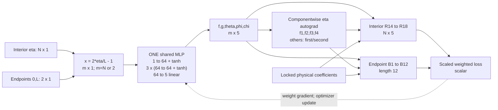

# From the Lorenz PINN to the fixed-case BVP

## Purpose and evidence

This is the checked source comparison behind the [architecture diagram](methodology.md#architecture-diagram-box-by-box). Open the [PDF architecture](figures/bvp-pinn-architecture.pdf), [SVG](figures/bvp-pinn-architecture.svg) or [editable HTML](figures/bvp-pinn-architecture.html). It explains the network, derivative, physics and optimizer loop. The [strategy](../plans/strategy.md) still controls the gates: complete parameters, software tests, reference, training, then evaluation.

The dated [parameter record](../problem/parameters.md#supervisor-confirmation-2026-11-16) locks all 22 physical coefficients. Numerical settings remain proposals, including eight null settings in [training-proposal.json](../../configs/training-proposal.json). Software validation, reference computation, training and evaluation remain pending. This document reports source inspection and parameter-count arithmetic, not test results.

Lorenz code authority is the live sibling repository at `0c5f9c86c597bd27897632fb917d6d17548eeffc`. Its tracked files were unchanged when inspected. Its untracked methodology notes and `uv.lock` supply no evidence here. Sources below identify exact files and lines; prior reported run results are not carried forward.

## What the Lorenz implementation actually does

The [README diagram](../../../lorenz1960-pinn/README.md), lines 90-100, correctly shows the main loop: coordinate, MLP, trial solution, coordinate differentiation, fixed physics, residual, loss and weight update. [Model code](../../../lorenz1960-pinn/src/pinn/pinn.py), lines 35-65 and 124-153, defines this calculation. Default settings are four width-60 tanh layers, three outputs and float32, with a hard initial condition ([configuration](../../../lorenz1960-pinn/src/pinn/config.py), lines 43-63). The trial is `u=u0+((t-t0)/(tf-t0))*N(t)` ([trial code](../../../lorenz1960-pinn/src/pinn/functions/trial.py), lines 4-7).

The actual paper reference is [the TikZ architecture figure](../../../fydp_workspace/paper/latest/figures/fig_4_1_pinn_architecture.tex), lines 34-84. Two labels need correction before adaptation:

- Including biases, the implemented architecture has `(1*60+60)+3*(60*60+60)+(60*3+3)=11283` trainable parameters, not the figure's 11163.
- [Loss code](../../../lorenz1960-pinn/src/pinn/functions/losses.py), lines 5-6, averages all entries of the N-by-3 residual: `sum(r²)/(3N)`. The figure's `sum(||r||²)/N` is three times that objective.

The paper's generic ANN discussion uses supervised reference targets and an 80/20 split ([design chapter](../../../fydp_workspace/paper/latest/3.design.tex), line 127). That is not this PINN's training logic. Reference values are absent from its residual loss. They are precomputed before optimization and logged during training ([trainer](../../../lorenz1960-pinn/src/pinn/train.py), lines 83-89 and 163-164), rather than computed only afterward as the figure suggests.

The single-domain trainer returns terminal weights, not an independently ranked best checkpoint (lines 134-216). [Optimizer code](../../../lorenz1960-pinn/src/pinn/functions/optimizers.py), lines 6-30, implements default linear Adam decay and optional L-BFGS. L-BFGS is disabled by default in the configuration, line 52.

## Retain and replace

| Retain from Lorenz | Replace for this BVP |
|---|---|
| One pointwise smooth MLP and fixed physics arithmetic | Eta input; five physical outputs; locked coefficients |
| Componentwise coordinate autograd | First through fourth derivatives of f; first and second of other fields |
| Residual-based training without reference labels | Five equation terms plus twelve soft boundary terms |
| Backpropagation and optimizer updates of NN weights | Proposed float64, width-64 network; declared Adam/refinement contract |
| Separate reference diagnostics and saved states | Validated solve_bvp reference, independent monitor ranking and withheld final evaluation |

Hard Lorenz initial-condition construction does not transfer to coupled endpoint conditions. Neither causal weights nor time-window state handoff belongs here. This is one fixed-parameter spatial interval, not temporal rollout or supervised curve fitting.

## Proposed architecture and shape flow

Architecture choices come from the [strategy](../plans/strategy.md#4-network-and-derivatives) and training proposal, not from supervisor values. The proposed `1-64-64-64-64-5` model has `(1*64+64)+3*(64*64+64)+(64*5+5)=12933` weights and biases. Tanh and float64 support the intended high-order calculation; they do not establish derivative accuracy.



Endpoint and interior calls share exactly the same weights. They are not two networks. Each physical column and derivative stays N-by-1 before stacking, preventing accidental N-by-N broadcasting. The boundary branch uses endpoint traces from that same function.

Coordinate differentiation computes `d^k u/deta^k`. Weight differentiation computes `grad_w J` through those derivative graphs. [Lorenz's derivative helper](../../../lorenz1960-pinn/src/pinn/functions/derivative.py), lines 5-7, differentiates each column separately with `create_graph=True`; the BVP repeats that operation to the required order. Summing samples works only with independent rows. Never sum different physical columns together or detach derivatives entering loss.

Differentiate through internal normalization with respect to eta. Autograd then includes `(2/L)^k` once. Do not multiply by it again. Analytic derivative, normalization, shape and weight-gradient tests must precede physical runs.

## Loss, selection and final checking

Keep [Eqs. 14-19](../problem/equations.md) unchanged. The baseline objective is

```text
J = sum_i lambda_i * mean((R_i/s_i)^2)
    + sum_j mu_j * (B_j/t_j)^2
```

Scales and weights are fixed and positive; scale values remain pending. Report original errors too. All twelve conditions enter softly, including coupled relations such as `g(0)+ell*f2(0)=0`. Neither `f(L)=0` nor independent zero slopes replacing the zero-flux cancellation may be added. The fixed physics calculation is not another trainable network.

Before training, freeze settings and pass software tests. Then validate the same twelve-state BVP with solve_bvp, checking regularity, guesses, mesh, tolerance, domain and branch-specific uncertainty. Reference failure blocks the baseline gate; separately authorized exploration remains unverified. Reference curves never become training labels.

Follow [monitor-based checkpoint selection](../plans/strategy.md#9-adam-training-flow), not Lorenz's terminal-model return. On an independent fixed monitor, define Q as the largest threshold-normalized scaled residual RMS, residual maximum or absolute boundary error. Minimize `(Q,J_monitor,E,o)` lexicographically, where E counts cumulative full-objective evaluations and o is checkpoint order. Thresholds and cadence must be declared first. Reference errors and final points never rank candidates.

Refine the best eligible Adam state with a frozen objective and fresh closure graphs. Preserve Adam if refinement fails or does not improve monitor rank; record the reason. After model lock, generate fresh dense/random evaluation sets. Report every original/scaled residual and boundary error, five fields, f-prime, wall derivatives and reference uncertainty. Smooth curves or low training loss alone do not pass acceptance.
