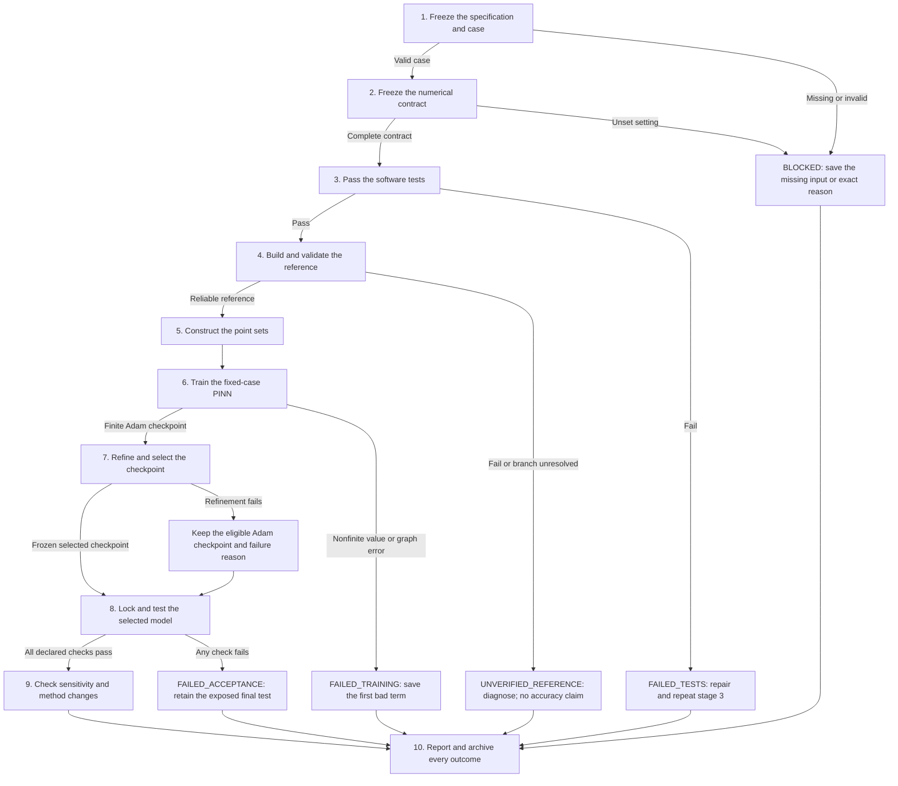
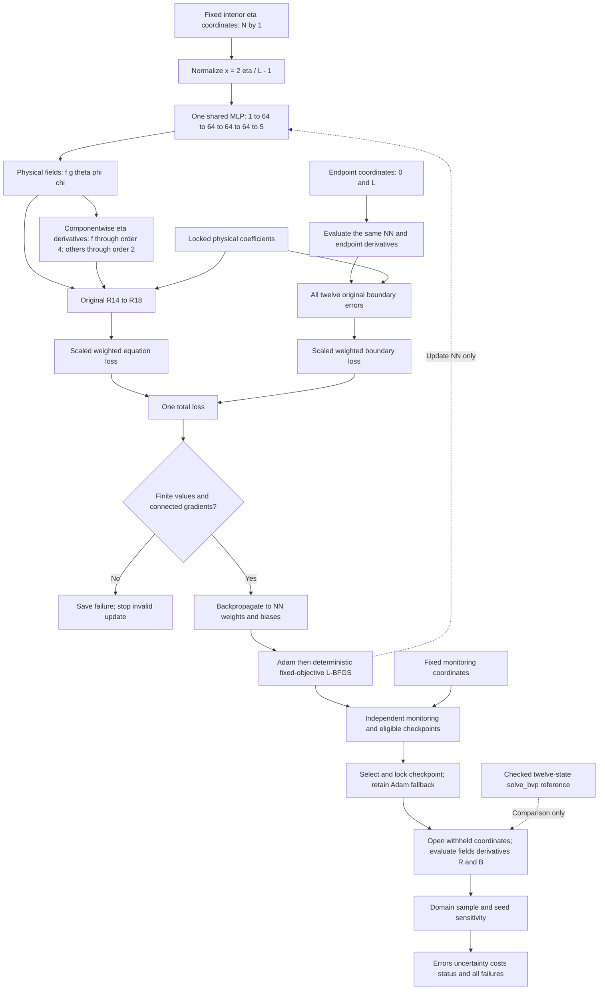
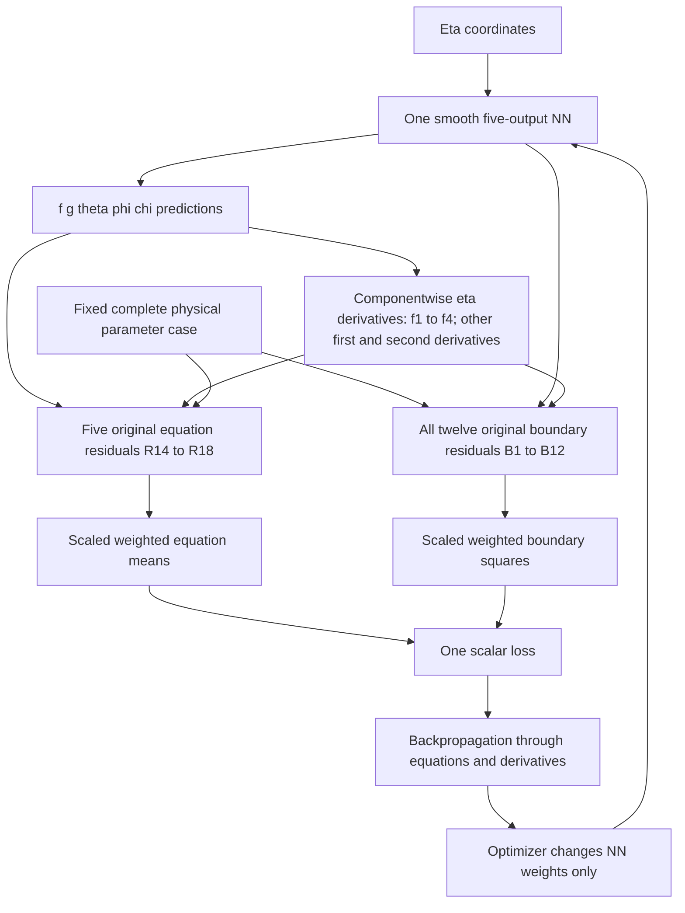
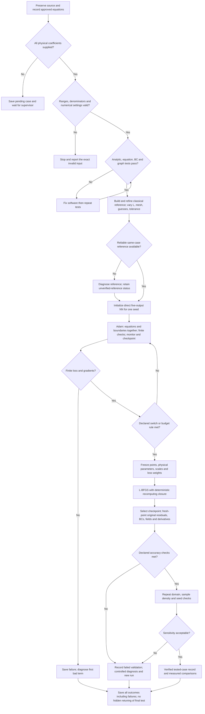
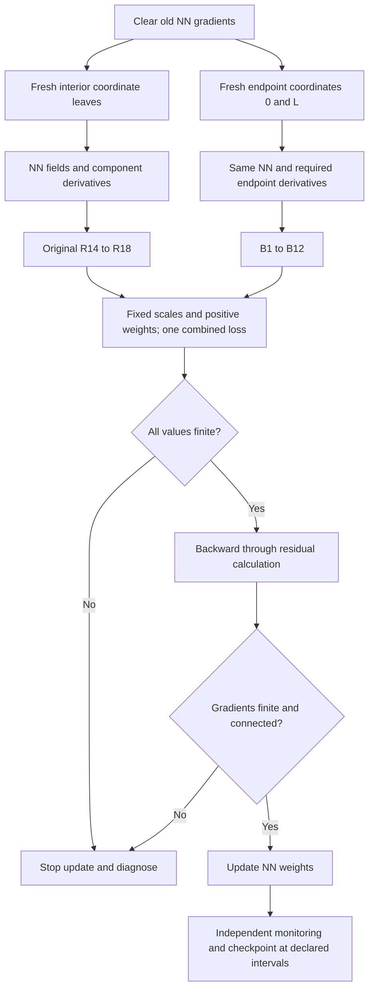
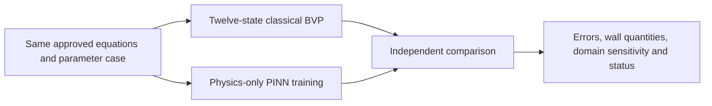

# Flowcharts

The browser-readable [strategy guide](../strategy-guide.html) renders these flows as labeled steps and branches. Mermaid source below is editable documentation, not code that trains a network.

## Deterministic methodology overview

These stage numbers match [the detailed methodology](methodology.md). The [HTML diagram](../bvp-methodology.html) and [PDF diagram](../bvp-methodology.pdf) show five small tasks per stage, with separate mathematical strips. The builder checks these stage labels against the methodology source. The locked case has all 22 physical coefficients; software tests and numerical choices remain pending. A failed reference never becomes a verified result through a later residual check.

Separately approved exploration without a reference may use stages 5 to 7. It retains the unverified-reference status and cannot pass the reference-based acceptance rule. A redesign after final testing is a new logged run, never a hidden retry of the same test.

## Lorenz-style BVP computational graph

This diagram follows the live Lorenz PINN's network, derivative, physics and optimizer structure, adapted to this two-ended BVP. See [the comparison](lorenz-to-bvp-methodology.md). It uses one shared network, not a separate trainable physics network. The complete method remains in [methodology.md](methodology.md).

Reference values and final-test errors feed neither the training loss nor checkpoint ranking. Coordinate differentiation keeps a graph for the later loss-to-weight backward pass. The baseline has no Lorenz initial-value lift, time windows, endpoint handoff or causal weighting.

## Architecture and gradient flow

Physical parameters feed the equation and boundary arithmetic only. They are not in the optimizer's parameter list. The network, equations and boundary checks share one differentiable computation.

## Full run with blocking and failure paths

## One Adam update

## Reference check is not training data

There is no arrow from reference values to the training loss. A separate supervised or reference-pretrained variant would need a different diagram and an explicit report of data use.
