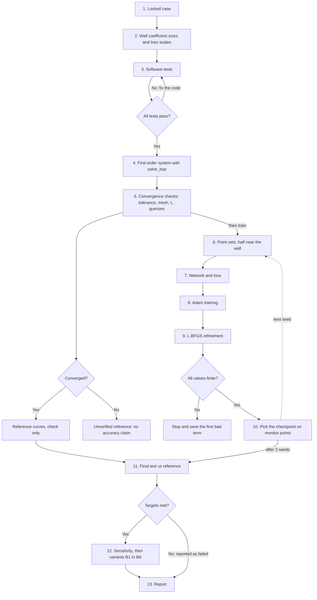
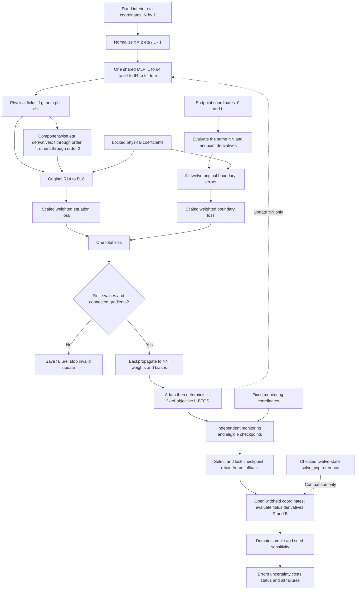
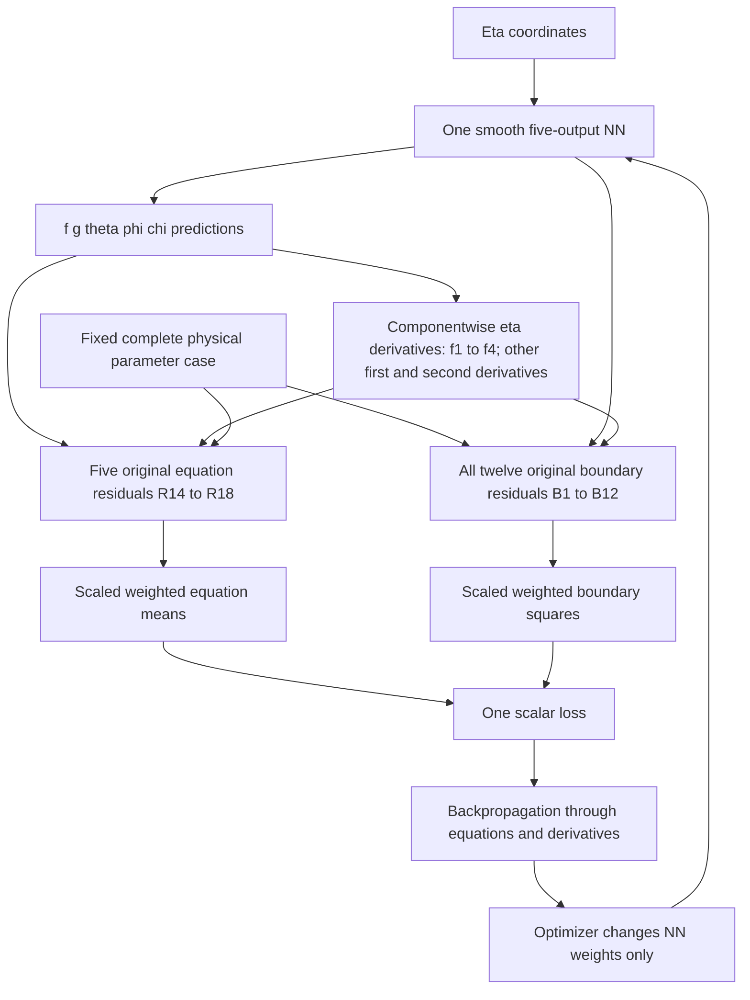
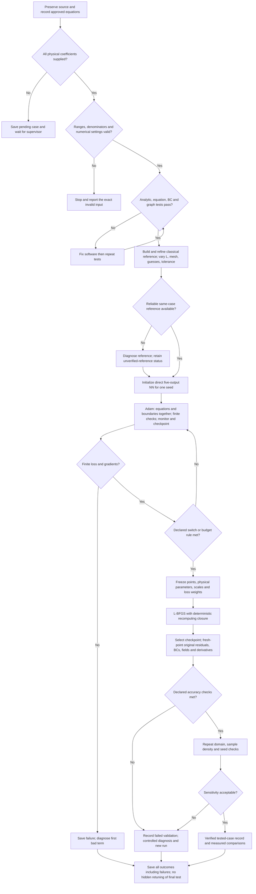
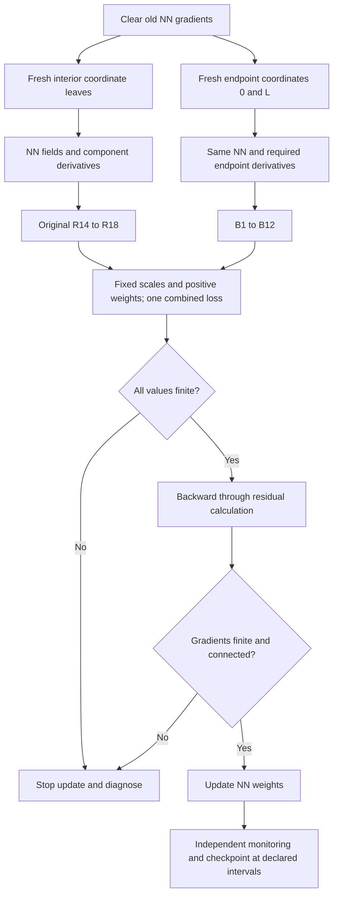
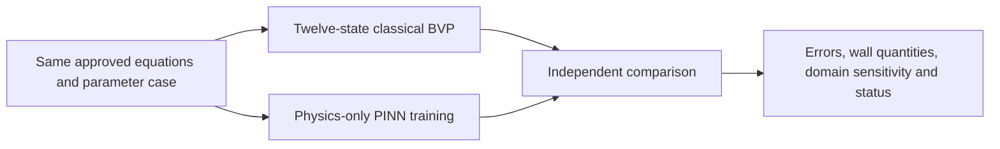

# Flowcharts

The browser-readable [strategy guide](../strategy-guide.html) renders these flows as labeled steps and branches. Mermaid source below is editable documentation, not code that trains a network.

## Methodology overview

Same numbers as the [methodology diagram](../bvp-methodology.pdf) and [its guide](methodology.md).

## Lorenz-style BVP computational graph

Text version of the [architecture diagram](../bvp-pinn-architecture.pdf). It follows the Lorenz PINN's loop, changed for this two-ended BVP. See [the comparison](lorenz-to-bvp-methodology.md). One shared network, no separate trainable physics network.

Reference values and final-test errors feed neither the training loss nor checkpoint ranking. Coordinate differentiation keeps a graph for the later loss-to-weight backward pass. The baseline has no Lorenz initial-value lift, time windows, endpoint handoff or causal weighting.

## Architecture and gradient flow

Physical parameters feed the equation and boundary arithmetic only. They are not in the optimizer's parameter list. The network, equations and boundary checks share one differentiable computation.

## Full run with blocking and failure paths

## One Adam update

## Reference check is not training data

There is no arrow from reference values to the training loss. A separate supervised or reference-pretrained variant would need a different diagram and an explicit report of data use.
