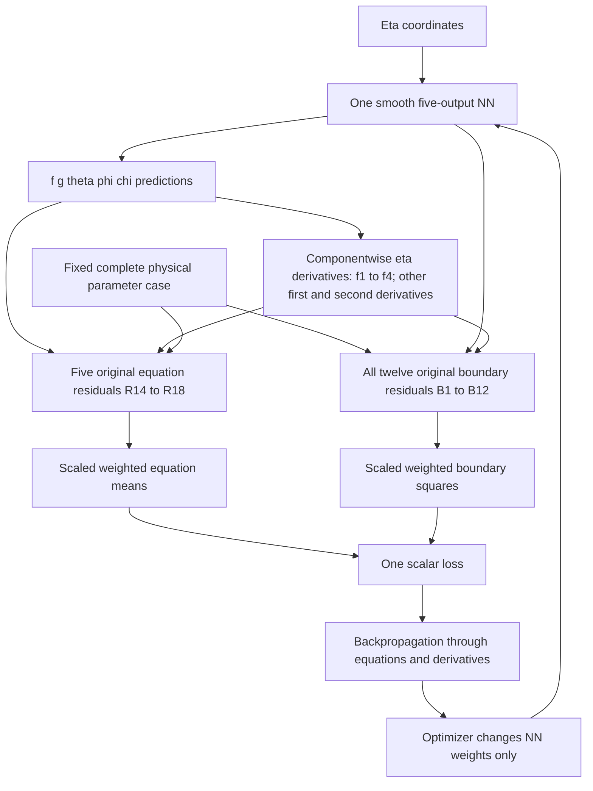
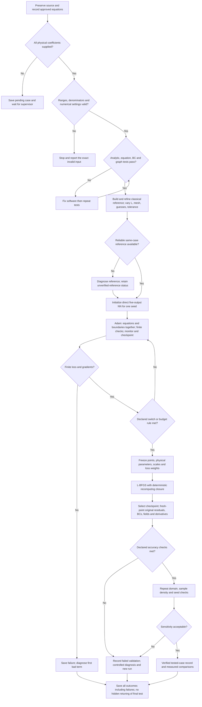
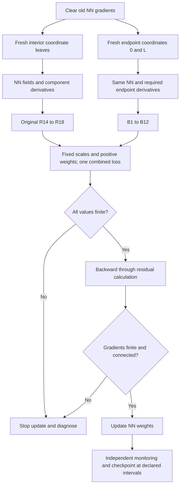
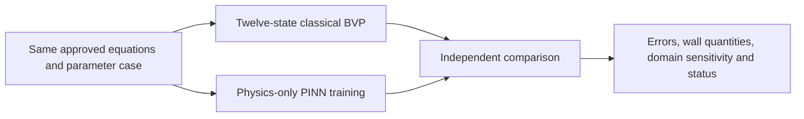

# Flowcharts

The browser-readable [strategy guide](../strategy-guide.html) renders these flows as labeled steps and branches. Mermaid source below is editable documentation, not code that trains a network.

## Architecture and gradient flow

Physical parameters feed the equation and boundary arithmetic only. They are not in the optimizer's parameter list. The network, equations and boundary checks share one differentiable computation.

## Full run with blocking and failure paths

## One Adam update

## Reference check is not training data

There is no arrow from reference values to the training loss. A separate supervised or reference-pretrained variant would need a different diagram and an explicit report of data use.
