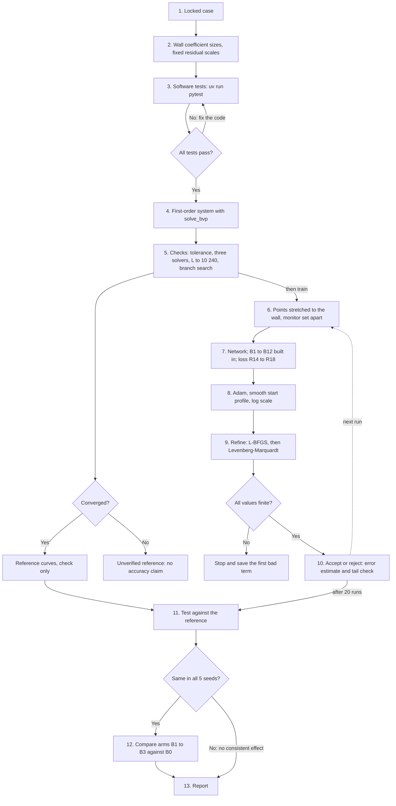
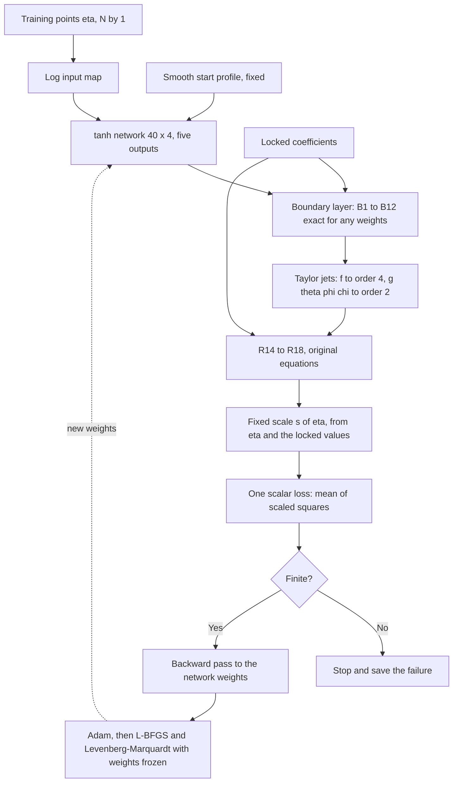
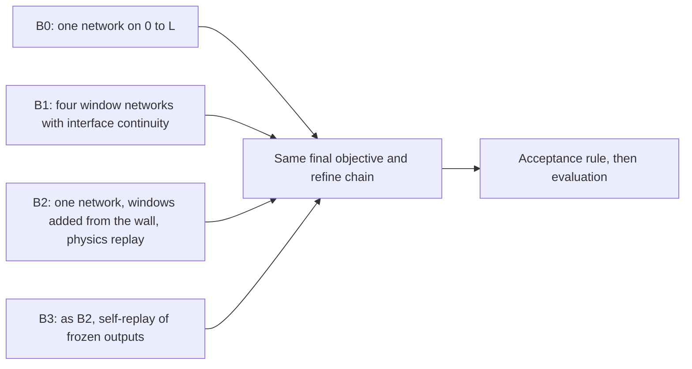
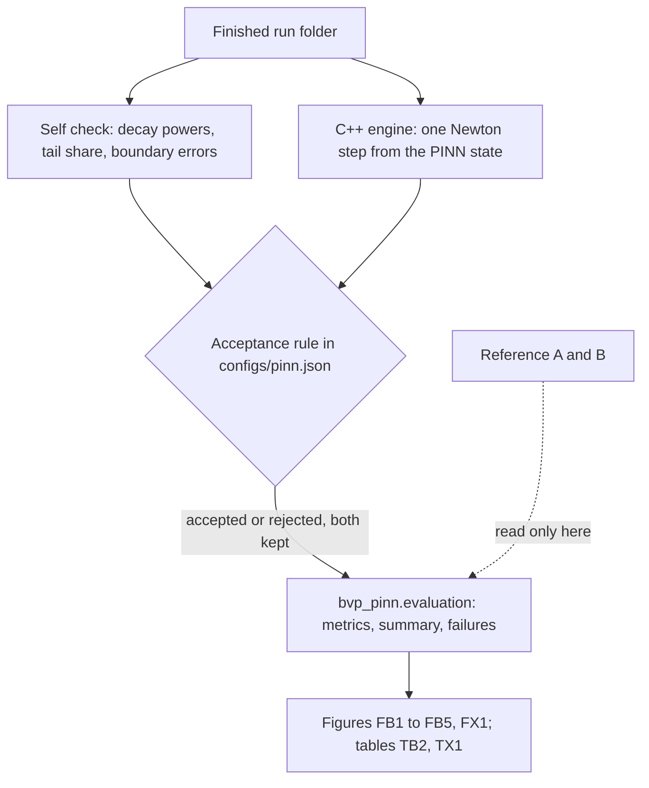

# Flowcharts

Editable Mermaid text versions of the method, updated 2026-11-24 to the code in `src/bvp_pinn/`. The browser-readable [strategy guide](strategy-guide.html) renders them; rebuild it with `python3 -I tools/build_guide.py`. The one-page diagrams are in [methodology.md](methodology.md).

## Methodology overview

Same numbers as the [methodology diagram](figures/bvp-methodology.pdf).

## One training step

Text version of the [architecture diagram](figures/bvp-pinn-architecture.pdf).

The locked coefficients are never in the optimizer's parameter list. In exact mode the boundary conditions hold by construction, so the loss holds only the equations.

## The four arms

Window edges 0, 0.5, 2, 6, 20 are pilot values until pilot P3 freezes them ([PINN_PLAN.md](../pinn/PINN_PLAN.md) section 2).

## After training: acceptance, then evaluation

There is no arrow from the reference to training or to acceptance. `src/bvp_pinn/pinn/` never imports the reference data or the evaluation package, and a test checks it.
