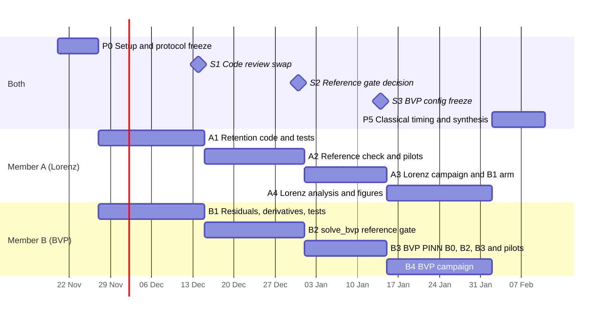

# Implementation workflow: two members, from code to understood results

Date: 2026-11-19. Scope: implementation, runs, figures and reading the results. Paper writing is out of scope here. Plan only; nothing in it has been run.

This plan replaces the BVP design in [single-network-retention.md](single-network-retention.md) sections 1 and 3 (the two-input network). Journal choice, compliance and the audit stay in [journal-strategy.md](journal-strategy.md).

Tags: **[J]** my judgment, **[A]** assumption.

## 1. Decisions this plan follows

Received from the user on 2026-11-19, reporting the supervisor's position:

| Decision | Effect on the plan |
|---|---|
| Try both structures, as in the Lorenz work: the basic windowed structure and knowledge retention, on Lorenz and on the BVP | Every problem gets a "basic" arm set and a "retention" arm set |
| BVP input is eta only. Physical parameters stay fixed values, never network inputs | The two-input u(eta, lambda) design is dropped. BVP retention must work over windows in eta (section 3.2) |
| No physical parameter sweep. Use the given values | Only the locked case in [parameters.md](../docs/parameters.md) is solved |
| The problem comes from M.J. Uddin and M.I. Hasan through the supervisor; we work on it with them | Ownership is settled as collaboration. Author order is still to be agreed, but it does not block implementation |
| The physical meaning of each parameter and variable is not needed. Use the values as given, build a numerical reference, train the PINN on eta, test it against the reference | All definition questions are closed. Every metric is a numerical comparison against the reference (section 5); nothing waits on a physical interpretation |

Continuation on kappa, b, Da (the debug path in [strategy.md](../docs/strategy.md) section 2) stays allowed only inside the classical reference, to find the locked-case solution. A PINN never trains at non-supervisor values unless the supervisor approves it as a fallback.

## 2. Team roles

| Member | Owns | Also does |
|---|---|---|
| **A: Lorenz lead** | All Lorenz arms, the shared results format, the figure style module | Builds the BVP subdomain arm (B1) in Phase 3, since it reuses window ideas; reviews B's residual code |
| **B: BVP lead** | BVP residuals, solve_bvp reference, BVP PINN arms | Reviews A's retention code; runs the classical timing for both problems |

Rule: nobody merges their own code. Each sync point includes a swapped review.

## 3. What gets built

### 3.1 Lorenz arms

Every arm uses the conference schedule: 27 windows, 1,536 points per window, four causal stages, then L-BFGS, 4x60 tanh, float64. Only the listed factor changes, so each comparison has a single cause.

| Arm | Structure | Retention | Compares against |
|---|---|---|---|
| L0 | 27 separate networks with warm start and endpoint handoff (conference method) | Not needed | Basic structure, upper PINN reference |
| L1 | One network on the full interval, same total steps | None | Known failure; matched rerun of the conference full-interval run |
| L2 | One network marched over the 27 windows | None (conference "shared network", rebuilt) | Shows forgetting |
| L3 | One network marched | Self-replay: match its own frozen outputs on anchor points in earlier windows (bc-PINN style) | Main retention arm |
| L4 | One network marched | Physics replay: keep the residual on a fixed-size sample of earlier windows | Second retention arm |

One network uses the hard initial state u(t) = u0 + t * N(t) over the whole interval. No endpoint handoff is needed.

Optional arms, if time allows:

- L5: L3 followed by a final full-interval L-BFGS polish.
- L3-wide: L3 with a 4x100 network, to check capacity.
- More initial states.
- 3 orbits.

### 3.2 BVP arms (eta only)

A BVP cannot be marched in eta: both ends carry conditions, so a window near the wall cannot be solved before the far field is known. The design avoids marching. **Every arm imposes all 12 boundary conditions at every training step.** A single network always has outputs at eta = 0 and eta = L, so this is possible at every stage.

Windows: K = 4 windows in eta, smaller near the wall. Example edges 0, 0.5, 2, 6, L. The final edges are set in Phase 3 from the reference and the pilot.

| Arm | Structure | What happens |
|---|---|---|
| B0 | One network, whole [0, L], all terms at once | The basic PINN |
| B1 | K separate networks, one per window, trained **together** | Interface conditions join neighbours: f, f', f'', f''' and g, g', theta, theta', phi, phi', chi, chi' continuous. This is the BVP form of "separate window networks" (cPINN/XPINN style) |
| B2 | One network, windows added from the wall outward. Physics replay: the residual stays on all windows reached so far | Stage k trains on [0, eta_k+1] plus all 12 BCs. The last stage is the full problem, then L-BFGS |
| B3 | Like B2, but self-replay: earlier windows held to the network's own frozen outputs; residual only on the new window | Mirrors L3 |

Honest note for the results: after its last stage, B2 has the same objective as B0. The difference is the path, so any gain is a curriculum effect, not new physics [J].

Fallback, only with supervisor approval, if every arm fails at the locked case: warm start from a solution at a debug-case value, labeled as such.

### 3.3 Shared rules for every run

- **Seeds:** 5 per arm (0 to 4). Paired across arms.
- **Selection:** by training residual only. The reference is opened once, after selection.
- **Run ID:** `{problem}-{arm}-s{seed}-{confighash8}`. Folder `runs/<run_id>/` holds:
  - `config.json`
  - `history.csv`: loss terms per step
  - `metrics.json`
  - `pred_eval.npz`: predictions and derivatives on the fixed evaluation grid
  - the final checkpoint
  - `meta.json`: git hash, hardware, threads, wall time
- **Summary:** one script reads all `metrics.json` into `results/summary.csv`. Figure scripts read only `summary.csv` and `.npz` files. They never train.
- **CPU use:** `torch.set_num_threads(1)` and up to 3 runs at once per laptop (4 threads, 7 GB RAM). Measure in the pilot that 3 parallel runs do not slow each other much.

## 4. Phases

Dates follow the base track: results understood by 10 Feb 2027, before FYDP-III ends in mid-February. The extension track adds Phase 6.

### Phase 0: Setup and protocol freeze (both, 20 to 26 Nov)

Work:

1. **Tag the conference code.** In lorenz1960-pinn, tag `iceeict2027-final` on commit `0c5f9c8` and work on a new branch `retention`. In this repo, BVP code lives in `src/bvp_pinn/`, rewriting patterns from `prior-work/`, not importing them (AGENTS.md and prior-work/README.md).
2. **Write `docs/run-protocol.md`** (about one page). It records:
   - the arms in section 3 and seeds 0 to 4
   - the metrics in section 5
   - the result schema in section 3.3
   - the gates in section 6, including the G4 bar (window-0 error grows less than 10x)
   - the selection rule

   After this file is committed, a threshold changes only with a dated note.
3. **Check what conference results can be reused.** List the checkpoints under `runs/causal-window/`. If all five L0 seeds can be reloaded and re-evaluated with the new evaluation script, reuse them. Otherwise re-run the missing seeds in Phase 2.
4. **Record the section 1 decisions** in [questions-for-supervisor.md](../docs/questions-for-supervisor.md) with the date.
5. If ICEEICT accepts the paper, one member owns the camera-ready (due 20 Dec). It must not change results.

Outcome: protocol committed, branches ready, reuse decision recorded.

Next phase gets: the frozen protocol, which every later script must follow.

### Phase 1: Core code and software tests (parallel, 27 Nov to 14 Dec)

**A1, Lorenz retention code:**

1. Add `n_windows` marching with one network: the window loop keeps one model and does not create a new one per window.
2. Add the anchor store. After window k, save the frozen predictions on a fixed-size anchor set from [0, t_k+1]. Store them as data, detached from the graph.
3. Add the self-replay loss (L3) and the physics-replay loss (L4) with weight beta or gamma from the config.
4. Rebuild L2 (marching, no retention) as config flags, not a code fork.
5. Tests:
   - the replay loss is zero when weights are unchanged
   - no gradient flows into stored anchors
   - the hard initial state holds exactly
   - anchors stay fixed across steps
   - a 3-window smoke run finishes and writes the full run folder
6. Write the shared result-summary script and the figure style module (fonts, sizes, colors).

**B1, BVP residuals and tests (gate G1):**

1. Implement the five residuals and twelve boundary errors exactly from [equations.md](../docs/equations.md), reading every coefficient from the locked config.
2. Derivative code: nested autograd for f up to the 4th derivative, others up to the 2nd.
3. Tests:
   - derivatives of known smooth functions (for example sin, exp, polynomials) match the analytic ones to near float64 rounding, orders 1 to 4
   - each residual on a hand-chosen function matches a SymPy evaluation of the same expression
   - the stable radiation form of B4 equals the original form where both apply
4. Build the 12-state first-order system and its boundary function for solve_bvp, as specified in [equations.md](../docs/equations.md).

**Sync S1 (14 Dec):** swapped review. A checks B's residuals term by term against equations.md. B checks A's retention code against bc-PINN's description in [single-network-retention.md](single-network-retention.md) section 2.

Outcome: tested code for both problems. G1 passed.

Next phase gets: trusted residual and retention code. No PINN result is believed before this point.

### Phase 2: References, pilots and gate decision (parallel, 15 to 31 Dec)

**A2, Lorenz reference and pilots (gate G2):**

1. DOP853 at four tolerance levels (rtol 1e-7 to 1e-10, atol 100x smaller). Pass: errors stable to 3 significant figures at the two tightest levels, and invariant drift below 1e-9.
2. Pilot L0 to L4 at seed 0, with full timing.
3. Pick the retention weight from a small grid (0.1, 1, 10), using **training residual only**.
4. Fix the step budgets so L1 to L4 match L0's total Adam steps and L-BFGS budget.
5. Re-run any missing L0 seeds.

Outcome: Lorenz configs frozen, run times known, campaign size checked against two laptops.

**B2, BVP reference gate (gate G3):**

1. Solve at L = 10, 15, 20, 30. At each L, use four mesh or tolerance levels (ratio 2).
2. Start from at least 5 different initial guesses.
3. If a direct solve fails, use continuation on kappa, b, Da inside solve_bvp only, and record the path.
4. Pass when:
   - the wall values f''(0), g'(0), theta'(0), phi'(0) and chi'(0) plateau
   - the observed order is at least 3.6 in the asymptotic range (a screening check, not a proof)
   - every guess reaches the same solution, or each branch is reported
5. Choose L, and save the reference on the evaluation grid with a SHA-256 hash.

Outcome: a trusted reference, or a documented failure.

**Sync S2 (31 Dec), decision:**

- G2 and G3 pass: go on.
- G3 fails: stop BVP PINN work, send the supervisor the failure evidence, and keep Lorenz moving. Do not change any physical value to make it pass.

Next phase gets: frozen Lorenz configs, the BVP reference with chosen L, and measured run times.

### Phase 3: Lorenz campaign starts, BVP PINN built (parallel, 1 to 14 Jan)

**A3:**

1. Launch the Lorenz campaign: 5 arms x 5 seeds = 25 runs (minus reused L0 seeds) in the background on A's laptop.
2. Check each finished run folder is complete.
3. While runs go, build BVP arm B1, the joint subdomain networks with interface conditions, on B's residual code.
4. Unit test: interface errors are zero for one smooth function copied into all windows.

**B3:**

1. Build B0. Pilot it with:
   - declared fixed scales from the reference magnitudes (fill the null scales in the training config)
   - wall clustering of collocation points
   - Adam, then L-BFGS
2. Read every loss term separately, not only the sum.
3. Build B2 and B3 on the same code (window schedule plus replay).
4. Pilot all four arms at seed 0.

**Sync S3 (14 Jan):**

1. Freeze the BVP configs: window edges, budgets, replay weight from the 0.1/1/10 grid by training residual only.
2. Record pilot failures as results, not as bugs to hide.
3. If B0 cannot reach the reference wall values within 10% in the pilot, record that, and try only the declared fixes in order: scales, then clustering, then a longer budget. Then freeze anyway.

Outcome: Lorenz runs in progress; all BVP arms working at pilot level.

Next phase gets: frozen BVP configs and a running Lorenz campaign.

### Phase 4: BVP campaign and Lorenz analysis (parallel, 15 Jan to 1 Feb)

The conference is 28 to 30 Jan. Whoever presents should launch their runs before leaving.

**B4:**

1. Run the BVP campaign: 4 arms x 5 seeds = 20 runs.
2. Check each run folder.
3. Log diverged or stalled runs in `results/failures.md` with the loss history. They stay in all tables.

**A4, Lorenz analysis:**

1. Build `summary.csv` for Lorenz.
2. Make the Lorenz figures and tables (section 7).
3. Answer the Lorenz questions in section 8 in writing, one paragraph each, each with its figure number and run IDs.

Outcome: Lorenz results understood; BVP runs complete.

Next phase gets: a Lorenz results memo and the full BVP run set.

### Phase 5: BVP analysis, classical timing, synthesis (both, 2 to 10 Feb)

1. **B:**
   - Build the BVP summary, figures and tables (section 7).
   - Answer the BVP questions in section 8.
2. **Both, classical comparison:**
   - On one laptop with one thread, time DOP853 and solve_bvp to reach each PINN arm's median error.
   - Record each PINN's error at the classical solver's time. Repeat timings 5 times and use the median.
3. **Both, synthesis meeting:**
   - Go through the cross-problem questions in section 8.
   - Write `results/results-memo.md`: one page of findings, each linked to figures and run IDs, plus a list of what did not work.
4. **Freeze:**
   - Tag the commit.
   - Hash the `results/` folder.
   - Hand the memo, figures and tables to the writers.

Outcome: every number the paper needs, with its source run.

Next: writing, which is out of scope here. Buffer 11 to 15 Feb.

### Phase 6: Optional tier (extension track only, 16 Feb to 1 Mar)

Run in this order, stopping when time runs out:

1. L5 polish.
2. Two more Lorenz initial states for L0, L3 and L4.
3. 3 orbits for L0 and L3.
4. L3-wide.
5. Cheap Lorenz error estimator on saved networks (see [journal-strategy.md](journal-strategy.md) section 6.8).

Each item updates `summary.csv` and the memo. None of them changes Phase 5 numbers.

## 5. Metrics (same names in every run)

| Metric | Lorenz | BVP |
|---|---|---|
| Relative L2 and max error per field, on the evaluation grid | x, y, z | f, f', g, theta, phi, chi |
| Combined RMSE | As in the conference paper | Not used |
| Residual mean square, per equation, on the evaluation grid | 3 components | R14 to R18 separately |
| Boundary or initial error, per condition | Hard IC, exact | B1 to B12 separately |
| Wall quantities | Not used | f''(0), g'(0), theta'(0), phi'(0), chi'(0) vs reference, absolute and relative |
| Error per window after each stage (retention arms) | Window 0 to 26 | Window 1 to K |
| Invariant drift | Both invariants | Not used |
| Cost | Wall time, Adam steps, L-BFGS calls, parameters, threads | Same |

## 6. Gates (pass or fail, set before any run)

| Gate | When | Pass rule |
|---|---|---|
| G1 code | End of Phase 1 | Derivative and residual tests pass (section 4, B1 and A1) |
| G2 Lorenz reference | Phase 2 | Stable to 3 significant figures at two tightest tolerances; invariant drift below 1e-9 |
| G3 BVP reference | Phase 2 | Wall values plateau over L and mesh; observed order at least 3.6 in the asymptotic range; branch check done |
| G4 retention | Phase 4 | Lorenz: window-0 error grows less than 10x over the later windows in L3 or L4. BVP: reported, no bar |
| G5 no leakage | Before Phase 3 runs | Code review shows the reference is not read during training or selection |
| G6 claim | Phases 4 and 5 | "X beats Y" only if it holds in all 5 paired seeds; otherwise say "no consistent effect" |

## 7. Figures and tables to produce

All figures come from `summary.csv` and `pred_eval.npz` through scripts in `tools/figures/`, using the shared style module.

| ID | Content | Owner, phase |
|---|---|---|
| FL1 | Trajectory of L0 and L3 against DOP853 (median seed) | A, P4 |
| FL2 | Error against time, all arms, median line and min-max band | A, P4 |
| FL3 | Window-0 error after each stage, L2 vs L3 vs L4 (the forgetting plot) | A, P4 |
| FL4 | Error against parameter count and Adam steps, every seed as a point | A, P4 |
| FL5 | Retention weight pilot: training residual against weight | A, P2 |
| FL6 | Invariant drift, all arms | A, P4 |
| TL1 | Median and range of RMSE, max error, residual, per arm | A, P4 |
| FB1 | Five profiles, B0 and best retention arm, against solve_bvp | B, P5 |
| FB2 | Pointwise error against eta, log scale, with near-wall inset | B, P5 |
| FB3 | Final residual per equation and error per boundary condition, per arm | B, P5 |
| FB4 | Training curves of each loss term, seed 0, per arm | B, P5 |
| FB5 | Error per window after each stage, B2 and B3 | B, P5 |
| TB1 | Reference L study and mesh study (from G3) | B, P2 |
| TB2 | Wall quantities, all arms against reference, median and range | B, P5 |
| FX1 | Error against wall time, PINN arms and classical solvers, both problems | Both, P5 |
| TX1 | Cost table, both problems | Both, P5 |

## 8. Questions the results must answer

Write each answer as: finding, evidence (figure, run IDs), and confidence (all 5 seeds agree, or not).

**Lorenz:**

1. Does a single network without retention forget? (L2, FL3)
2. Does retention stop it? Which form, self-replay or physics replay? (L3 vs L4, FL3, G4)
3. How close does one network get to 27 networks, and at what parameter and step cost? (L0 vs L3/L4, FL4, TL1)
4. Where does the error build up, and does the residual show it? (FL2, residual per window)
5. Does the matched full-interval run still fail? (L1)

**BVP:**

1. Does the basic single network reach the reference wall quantities? Which equation or condition limits it? (B0, FB3, TB2)
2. Do separate subdomain networks help near the wall? (B1 vs B0, FB2)
3. Does adding windows from the wall outward help, and does physics replay or self-replay do better? (B2, B3 vs B0, FB5)
4. Where is the error largest, and does the residual point to the same place? (FB2 vs FB3)

**Across both:**

1. Does the same idea (one network plus retention) help in both problems, in one, or in neither? Say it plainly either way.
2. How far behind classical solvers are the PINNs at equal time? (FX1)

## 9. Order and dependencies at a glance

| Step | Needs | Can run in parallel with |
|---|---|---|
| P0 protocol | Nothing | Nothing (both members) |
| A1 Lorenz retention code | P0 | B1 |
| B1 BVP residuals | P0 | A1 |
| S1 review swap | A1, B1 | Nothing |
| A2 Lorenz reference and pilots | S1 | B2 |
| B2 solve_bvp gate | S1 (B1 code) | A2 |
| S2 gate decision | A2, B2 | Nothing |
| A3 Lorenz campaign, build B1 arm | S2 | B3 |
| B3 BVP arms and pilots | S2 | A3 |
| S3 BVP freeze | B3, A3's B1 arm | Lorenz runs continue |
| A4 Lorenz analysis | Lorenz campaign done | B4 |
| B4 BVP campaign | S3 | A4 |
| P5 synthesis | A4, B4 | Nothing (both members) |

## 10. Risks by phase

| Phase | Risk | Response |
|---|---|---|
| P1 | 4th-order autograd is slow or inaccurate | Test first (G1). If slow, reduce points in pilots, not in final runs |
| P2 | solve_bvp does not converge at the locked case | Continuation inside the reference only; more guesses; longer L. If still failing, report to supervisor with evidence; Lorenz continues |
| P2 | Lorenz runs too slow for 25 runs | Use both laptops and free cloud CPU; drop optional arms, never seeds |
| P3 | BVP PINN stalls (likely near the wall) | Declared fixes in order: scales, clustering, budget. Then freeze and report |
| P3 | B1 interface conditions make training unstable | Report it; B1 is a comparison arm, not the main claim |
| P4 | Conference travel stops runs | Launch before leaving; runs need no attention |
| P5 | A result contradicts the story | Report it. The questions in section 8 are answered either way |
